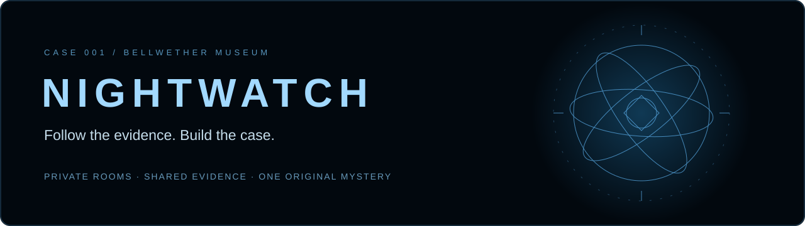

<p align="center">
  
</p>

<p align="center">
  <a href="https://nightwatch-meridian.app.space"><strong>Play Nightwatch</strong></a> ·
  <a href="docs/FEATURES.md">Gameplay</a> ·
  <a href="docs/ARCHITECTURE.md">Architecture</a> ·
  <a href="docs/VERIFICATION.md">Testing</a>
</p>

<p align="center">
  <a href="https://github.com/Adhi7783/Nightwatch/actions/workflows/ci.yml"></a>
  
  
</p>

# Follow the evidence. Build the case.

Nightwatch is a cooperative detective game for one or two investigators. Enter a private room, explore a museum after a heist, and turn scattered discoveries into a supported explanation.

The Glass Meridian has vanished from a sealed display at the Bellwether Museum. The lock is intact. Three people have a story. The evidence has another.

**One original, hand-authored mystery. Ten evidence files. Three suspects. A complete reveal.**

## Inside the investigation

- **Persistent detective profiles:** sign in through DeepSpace, choose a name, and return to saved cases.
- **Private rooms:** investigate solo or invite one partner before the host begins.
- **A shared caseboard:** drag cards, connect clues to suspects or other evidence, label relationships, and leave contextual notes.
- **Safe collaboration:** shared layouts persist, camera movement stays personal, and conflict checks protect a partner's newer edits. Undo restores eligible changes.
- **A narrated opening:** a feminine computer voice introduces each new case with synchronized text. Replay only the voice whenever needed.
- **Reasoned conclusions:** choose a suspect, method, motive, and supporting evidence. The server validates the accusation. Two investigators must agree.
- **A lasting case report:** unlock the full explanation, chronology, recovery, and contribution history, then export a PDF.
- **A holographic command interface:** black surfaces, translucent blue light, original rotating 3D machinery, keyboard alternatives, and a mobile list view.

## How to play

1. [Open Nightwatch](https://nightwatch-meridian.app.space) and sign in with GitHub or Google.
2. Choose a detective name, then create a private case, resume a save, or join with an invitation.
3. Hear the briefing. Invite a partner or start solo. Only the host starts the investigation.
4. Use **Investigate** to explore four museum locations and read suspect accounts. Share discoveries with your room.
5. Use **Caseboard** to arrange evidence and record connections. Choose Supports, Contradicts, or Possibly related and explain your reasoning.
6. Use **Conclusion** to submit a supported accusation and read the final report.

Starting a new case asks whether to resume an existing save or create a fresh room. Delete removes an entry from your own archive and offers Undo. Your partner's save and the shared investigation remain intact.

Connections are working theories. The board does not grade every pair or reveal the answer through trial and error. Incorrect accusations remain spoiler-safe. Both investigators can instead agree to reveal the solution and close the case.

## Built with DeepSpace

| Layer | Technology | Purpose |
| --- | --- | --- |
| Interface | React, TypeScript, Vite | Investigation screens and interactive evidence canvas |
| Identity | DeepSpace authentication | Persistent, account-owned detective profiles |
| Shared state | DeepSpace RecordRoom | Private case records, live subscriptions, and persistence |
| Server | Hono on Cloudflare Workers | Verified identity, membership, and game rules |
| Narration | ElevenLabs through DeepSpace | Authored speech and character timing |
| Evidence assistant | Anthropic through DeepSpace | Source-verified observations from earned evidence |
| Report export | CloudConvert through DeepSpace | Closed-case HTML to PDF |
| Visuals | Native WebGL with Canvas 2D fallback | Original instrument and machinery geometry |

The mystery and its solution are authored. AI selects useful excerpts from clues you have earned; it does not invent evidence or judge accusations. Paid features are authenticated, cached, and rate limited. [Read the integration design](docs/INTEGRATIONS.md).

## Run locally

Use Node 24 and npm 11.6 or newer.

```sh
cd sdk
npm ci
npx deepspace auth login
npx deepspace auth whoami
npx deepspace dev start
```

From the repository root:

```sh
npm test
npm run type-check
npm run build
```

Keep the committed lockfile when installing dependencies. The application lives in `sdk/`; root scripts delegate build and development commands there.

## Deploy

Run `npx deepspace deploy` from `sdk/` using an authorized developer account. Preserve the app ID, BOARD binding, and existing room names to retain saved investigations.

GitHub is this app's canonical source. Push changes with ordinary Git. The checked-in `production-deploy.mjs` can publish a compiled CI artifact using the DeepSpace deployment protocol when local dependency installation is unavailable. Credentials stay local and must never be committed.

## Architecture and safeguards

Every game request uses verified platform identity and private room membership. Clients cannot write game records directly. Serialized server actions enforce game phase, host privileges, valid evidence, request deduplication, and deterministic accusations.

Card reservations and per-card revisions protect simultaneous moves. Connection versions protect edits and Undo. The browser keeps each investigator's pan and zoom independent.

The answer is returned only after the case closes. **The server source contains spoilers**, so avoid reading `sdk/src/server/case.ts` before playing. This public repository cannot prevent someone deliberately reading the authored solution.

## Testing

The latest release passed **35 unit tests**, **72 live game and archive checks**, and **20 integration checks**, alongside strict TypeScript and the production build. Browser checks cover the caseboard, mobile interactions, save dialogs, and processed narration playback.

The full two-browser UI specification is included but has not been executed. [Verification details and limits](docs/VERIFICATION.md) distinguish server tests from browser checks.

## Explore the code

| File | Responsibility |
| --- | --- |
| `sdk/src/game/Nightwatch.tsx` | App flow, authentication, and live room snapshots |
| `sdk/src/game/Caseboard.tsx` | Pointer and keyboard interaction with the evidence canvas |
| `sdk/src/game/save-archive.ts` | Personal save removal and restoration |
| `sdk/src/server/game-room.ts` | Serialized private case actions and persistence |
| `sdk/src/server/caseboard-actions.ts` | Reservations, version checks, links, and Undo |
| `sdk/src/server/case-services.ts` | Curated narration, recap, and report integrations |
| `sdk/src/game/rules.ts` | Deterministic accusation validation |

## More about Nightwatch

- [Gameplay and features](docs/FEATURES.md)
- [Product decisions](docs/PRODUCT.md)
- [Architecture and development](docs/ARCHITECTURE.md)
- [Integrations and usage limits](docs/INTEGRATIONS.md)
- [Visual direction](docs/VISUAL-DIRECTION.md)
- [Verification record](docs/VERIFICATION.md)
- [Playtesting guide](docs/PLAYTESTING.md)
